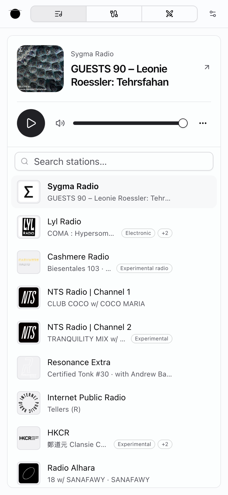
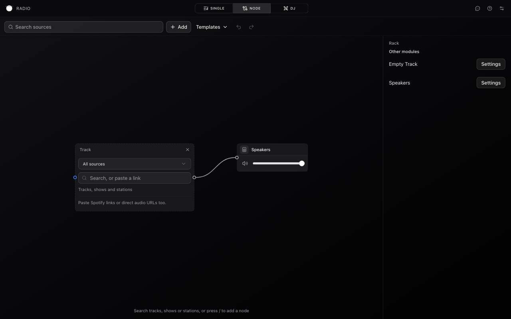
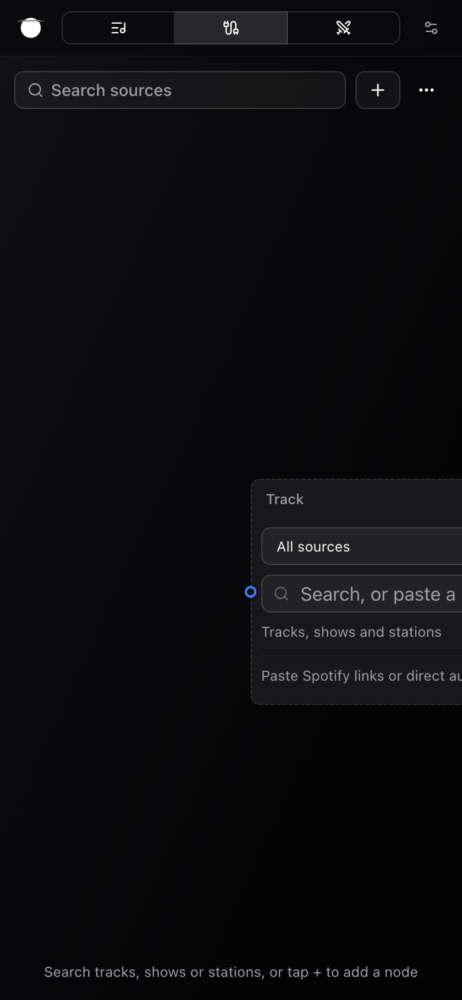
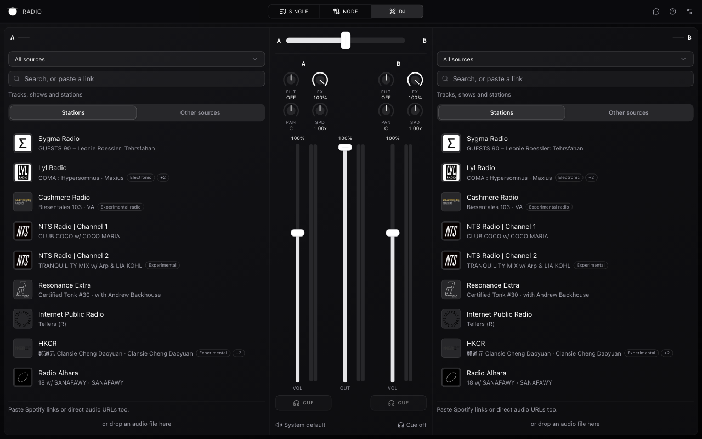
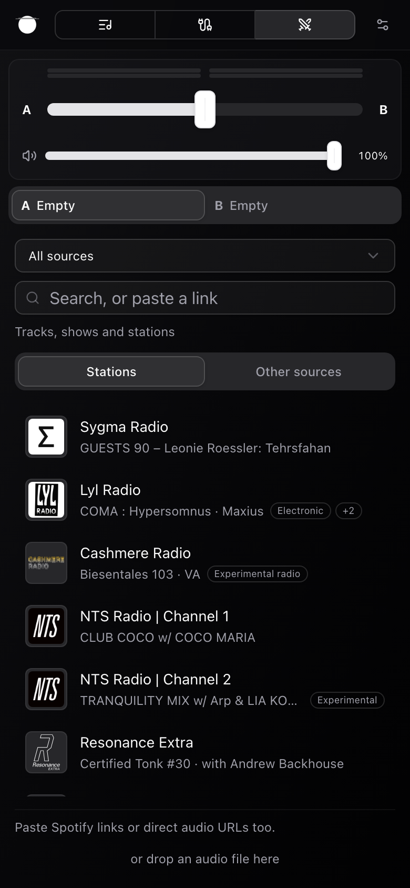
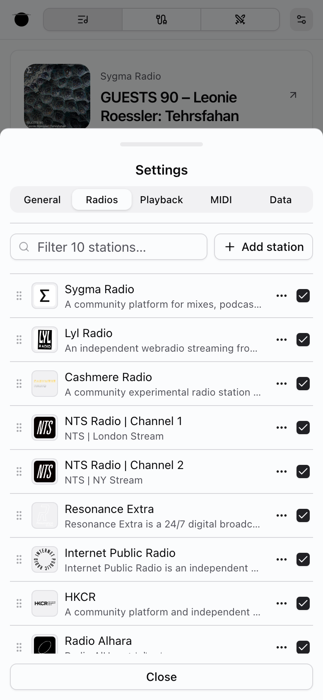
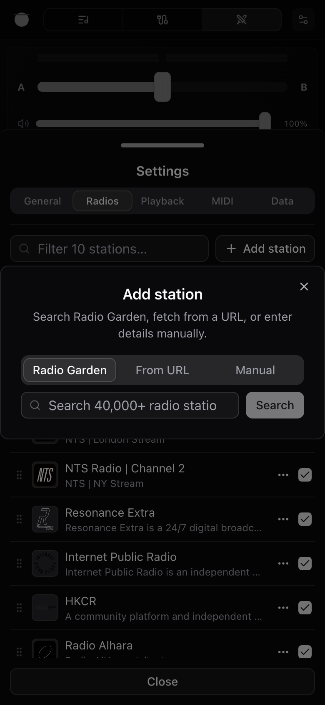

# Radio app: screen inventory and proposed structure (2026-11-01)

**Status:** proposal, first review with Francesco done (see Decisions). Most of it is agreed in principle; each slice gets a closer look when it is picked up. Tracks [NWS-2788](https://linear.app/nws2/issue/NWS-2788); implementation lands under NWS-2796.

**Decisions (2026-11-01, Francesco)**

1. **Settings becomes a modal, not a drawer.** On desktop it opens as a centred modal on top of whatever mode is running, like Notion's settings. On mobile it is a full-screen page (or a near-full sheet). The first screen lists the groups; tapping a group opens that group's page, with a back control. There are no tabs, so new groups can be added later without a tab-count limit. This replaces §4b's "keep five tabs" recommendation.
2. **Header, navigation and overall layout are Francesco's design work.** He is restructuring the app's wireframe, element positions and UX himself. §4c and the header slices are input for that work, not decisions, and are on hold until the wireframe exists.
3. **UX before UI.** The design-system work (tokens, Base UI) runs in parallel and is shown somewhere it can be worked on while the UX is reworked. Francesco already has some UI direction; it is not captured here yet.

**Guardrail:** restructure screens in `apps/radio` only. Do not edit `packages/ui` primitives, so this work can run in parallel with the tokens and Base UI migration. Fix touch targets with app-side `className` overrides or app wrappers, not by changing primitive sizes.

**Inputs:** a code inventory of `apps/radio/src` (four read-only passes: shell + Single, Node, DJ, secondary surfaces), the [2026-10-19 live audit](2026-10-19-live-audit.md), and the live-app UX defects table in [README §2](README.md#live-app-ux-defects-independent-of-the-primitive-migration). Line numbers were checked on `main` at `bd6d0c88` by the writer and a separate review agent.

**Paths.** Short paths are relative to `apps/radio/src/components/` (so `radio/dj/…` is `apps/radio/src/components/radio/dj/…`). `lib/…` is `apps/radio/src/lib/…`. Modes are listed in code order: Single, Node, DJ (`lib/types.ts:15-19`).

## 1. Inventory

### Surfaces

| Surface | Container | Entry, desktop (≥640px) | Entry, mobile (<640px) | Notes |
|---|---|---|---|---|
| Header | Fixed bar, 48px | Always | Always | Logo, mode switch, Feedback, What's new, Settings. Every icon button is forced to `size-7` (`theme/header.tsx:98`) |
| Single mode | `/` | Mode switch "Single" | Mode switch, icon only (`settings/mode-select.tsx:110`) | Station list + now-playing panel |
| Node mode | `/` | Mode switch "Node" | Mode switch, icon only | Phone layout below 768px (`radio/node/index.tsx:75`, `useIsMobile()` default); no Rack on phone |
| DJ mode | `/` | Mode switch "DJ" | Mode switch, icon only | Phone layout below **1024px** (`radio/dj/dj-player.tsx:53`) |
| Settings | Bottom drawer, 5 tabs | Header gear; DJ mixer routing line | Header gear | Opens on "Radios" (`settings/settings-form.tsx:93-99, 120`). Mobile tabs are `grid-cols-5`, icons hidden (`settings-form.tsx:179, 188`) |
| Add / Edit station | Dialog over the drawer | Settings › Radios › "Add station"; Edit from any station ⋯ menu | Same | Add is reachable only from Settings |
| Confirm delete, Reset | Dialog | ⋯ › Delete; Data › Reset | Same | Nested over the drawer |
| Station updates | Dialog, automatic at launch | None (no manual entry) | None | Skipped **updates** come back next launch; skipped **new stations** are remembered as dismissed (`settings/sync-dialog.tsx:200-201, 238`) |
| Import | Route `/import#data=…` | Share link | Share link | Duplicates Settings › Data › Import with different copy |
| Feedback | Dialog | Header icon | **Not reachable** | Wrapper is `hidden sm:contents` (`theme/header.tsx:99`) |
| What's new | Popover (`changelog/whats-new.tsx:134`) | Header "?" icon + unread dot | **Not reachable** | Icon is `CircleQuestionMarkIcon` (`whats-new.tsx:121`) |
| PWA install | Fixed bottom card | Automatic | Automatic | "Not now" snoozes 30 days; no other entry (`pwa/install-prompt.tsx:12`) |
| Legal | Route `/legal` | Settings › General › "Source and licenses" | Same | 404s in local dev (README §2 #11) |

### Task → screen matrix

✓ works · ⚠ friction · ✗ not possible · — not applicable

| Task | Single | Node | DJ | Settings | Other |
|---|---|---|---|---|---|
| Play / pause | ✓ Play button, Space | ⚠ per source; Space plays all, no visible button | ✓ per deck | — | — |
| Find a station | ⚠ "Search stations…"; result is temporary, marked only by a green border | ⚠ "Search sources" button **and** slot search "Search or paste a stream" | ⚠ "Search, or paste a link" + platform select + duplicate source tiles | ⚠ Add › Radio Garden tab, a fourth search | — |
| Play a pasted stream URL | ✗ runs a text search | ✓ | ✓ | ⚠ Add › From URL | — |
| Save a station | ⚠ bookmark or ⋯ › Save; "collection" never shown as a place | ⚠ station menu › Save | ✗ picks become temporary | ✓ Add station | — |
| Add a station by hand | ✗ | ✗ | ✗ | ⚠ 3 layers deep, dialog over drawer | — |
| Edit / delete a station | ⚠ ⋯ hidden until hover on desktop, 60% opacity on touch | ⚠ "Delete" next to "Remove node" | ✗ | ✓ | — |
| Hide / show a station | ⚠ ⋯ › Hide, then it is gone | ⚠ menu | — | ⚠ only way back: 18px checkbox | — |
| Reorder stations | ✗ | ✗ | ✗ | ⚠ faint grip; disabled silently while filtering | — |
| Switch mode | ⚠ header only; icon-only on mobile, tooltip needs hover | same | same | ✗ not in Settings (by design) | — |
| Volume | ✓ | ✓ Speakers ("Volume all") | ✓ channel + master ("out") | — | — |
| Effects / EQ | — | ⚠ effects added from + Add arrive unconnected | ⚠ per-deck accordion; EQ only as an effect; can't add to an empty deck | — | — |
| Cue / headphones | — | ⚠ strip cue | ⚠ needs a cue output set in Settings; tooltip says "audio settings", tab is "Playback" | ⚠ Playback › CUE output | — |
| Map MIDI | ⚠ "applies in DJ and Node" | ⚠ right-click only | ⚠ right-click only | ⚠ dense list, timed "Clear all" | — |
| Back up / share | — | ⚠ patch only in file backup, not in share link | — | ⚠ Data: "Export" vs "Download backup" vs "Create share link" | ⚠ `/import` page |
| Theme | — | — | — | ⚠ General tab, not default | — |
| Feedback / What's new | — | — | — | ✗ | ⚠ desktop header only |
| Install app | — | — | — | ✗ | ⚠ bottom card, 30-day snooze |
| Go home | ⚠ logo is `<a href="/">`, full reload stops audio | same | same | — | — |

## 2. Maps per mode

### Single

**Regions.** One card, `max-w-5xl` (`radio/single/single-player.tsx`). Desktop (≥1024px): station list left (`lg:w-80`), large now-playing right. Below 1024px: now-playing on top (only when a station is selected), list below. Short landscape: side by side.

**Primary tasks.** Play the current station, switch station, find and keep a new one, check what's on.

**Top problems**

1. Saved-row actions (Info, ⋯) are `opacity-0` until hover or focus on desktop and only 60% opacity on coarse pointers (`radio/single/single-player-station-list.tsx:111`). Temporary rows always show them at full opacity, so rows look inconsistent. 
2. Empty state says "Search to add a station", but a searched station is only temporary (tab-only `sessionStorage`). Adding a station for real lives in Settings.
3. Hide removes a station from the list; the only way back is the "Show X in player" checkbox in Settings › Radios (`settings/radio-management.tsx:122-128`).
4. Pasting a stream URL does nothing special: Single's `RadioSearchBar` gets no `onSubmitUrl` (`radio/single/single-player.tsx:219-224`), while Node's slot does (`radio/node/station-content.tsx:93`).
5. The artwork opens the details dialog but does not look clickable; the same link is called "Website", "Station website" and "Open source page".

### Node

**Regions.** Top row: "Search sources" popover + toolbar (+ Add, Templates, Undo/Redo). Desktop: resizable canvas + side panel (Rack, replaced by the Inspector whenever one node is selected). Phone (<768px): canvas only; Inspector as a bottom drawer on request. Bottom hint line. 

**Primary tasks.** Add a source, route it to Speakers, add and tune effects, play everything, undo.

**Top problems**

1. Mobile fit and focus: the canvas was not fitted and Tab reached off-screen controls with no auto-pan (README §2, High). The code now re-fits on phone after measuring (`radio/node/node-canvas.tsx:1054-1065`), but focus auto-pan is still React Flow's default. Needs a live re-check.  
2. Phone has no Rack, so no "Not connected" list and no compile issues; those appear only in the desktop Rack.
3. Many actions are keyboard-only with no visible control: C connect, I insert, B bypass, P/S parallel/series, ⌘D, F fit, Space play all. No visible "remove cable"; desktop has no Fit button.
4. Effects added from + Add arrive unconnected and silent; port names are hover-only `title`s; badges (`compat`, `bypassed`, `sum`, `closes`) are explained only on hover.
5. Three search entry points with different scope and wording: "Search sources", "Search or paste a stream", "All sources". The station menu puts "Remove node" next to library "Delete"; empty slots say "Remove empty Station / Track / File" (`radio/node/station-content.tsx:83`, `track-content.tsx:205`, `file-content.tsx:77`).

Housekeeping: the phone Stage/Rack/Patch tabs were removed, but `radio/node/node-stage.tsx` is still in the tree (only its test imports it), and `radio/NODE_MODE_PROPOSAL.md`, `radio/node/docs/acceptance.md`, `radio/node/branch-edge.tsx:26` and `radio/node/node-canvas.tsx:457` still describe the old phone tabs.

### DJ

**Regions.** Desktop (≥1024px): `Deck A | Mixer (21rem) | Deck B` (`radio/dj/dj-console.tsx`). Below 1024px: mini mixer bar on top (meters, crossfader, master; Cue A / Cue B only when a cue output is set, `radio/dj/dj-console-mobile.tsx:109, 147`), then deck tabs "A ‹name›" / "B ‹name›", one deck visible at a time. The library and search live inside each empty deck; there is no shared browser.  

**Primary tasks.** Load a source into each deck, play, crossfade, adjust channel level / filter, add effects, cue.

**Top problems**

1. No guidance: both decks open to a search form, and nothing says "load A, load B, crossfade".
2. Two platform pickers in the same empty deck: the "All sources" select and the "Other sources" tiles ("Search all"). Result badges are 2-letter codes; "FM" means the local library (`radio/dj/external-search/search-results.tsx:34`).
3. Tablets (768–1023px) get the phone layout and lose the cue volume knob, routing line and MIDI-learn wrappers. Channel controls move between the mixer and the deck depending on width.
4. Cue depends on a setting made elsewhere; the disabled desktop button's tooltip says "Set a cue output in audio settings" (`radio/dj/mixer/mixer-channel.tsx:183`) but the tab is "Playback". On mobile the cue buttons are not rendered at all until a cue output is set.
5. Hidden interactions: MIDI learn by right-click only, double-click reset, Q/W shortcuts, drag-and-drop files, hover-only Play on results, icon-only Repeat / Autoplay (the Autoplay icon is Single mode's icon).

### Shared surfaces

**Settings** (bottom drawer; tabs become a left rail at `md`). Today: General (Theme, Restore playback state, Version, GitHub, Source and licenses) · **Radios** (default: filter, Add station, reorder, ⋯, show-in-player checkbox) · Playback (outputs, delay, CUE, troubleshooting) · MIDI · Data (Export / Import / Reset). 

- Add station opens a centred dialog over the bottom drawer: two overlay patterns, two close affordances. 
- 79 targets under 44px on mobile (live audit). Reorder grip is faint; checkbox is 18px with no visible label.
- Reset says "stations and playback settings" but also wipes outputs and delays.
- `settings/SETTINGS_UX_DECISION.md` matches the code except the header: it says only What's new replaces the theme toggle; Feedback was added and both are desktop-only.

**Import** (`/import#data=`). "Import configuration"; Merge / Replace under a label called "Mode". A share link carries stations and the whole settings record (`lib/db/export-import.ts:500-510`). Import applies only the player mode and restore-state from it, keeping the existing mode when the link has none (`export-import.ts:312`), so **a share link can switch the recipient's mode**. It never carries the Node patch; a file backup does.

**Feedback.** Dialog "Radio feedback" (type + message, public GitHub issue warning). Desktop only. Close icon ≈16px (live audit).

**What's new.** Popover, 12 entries, version footer. Desktop only; "?" icon reads as Help; detaches top-left when resized from desktop to mobile (README §2).

**Station updates.** Automatic dialog at launch when built-in stations change; "Skip" / "Apply (n)". Skipped updates return next launch, but skipped new stations are dismissed for good, and there is no way to reopen the dialog.

**PWA.** Install card only; no permanent Install entry, no update prompt.

**Legal.** Only from Settings › General.

## 3. Cross-cutting problems

| # | Problem | Evidence |
|---|---|---|
| 1 | Feedback and What's new are unreachable on mobile; no menu holds them | `theme/header.tsx:29-36, 99` |
| 2 | Adding a station is buried in Settings; temporary vs saved stations are never explained (green border only) | `radio/single/single-player-station-list.tsx:66` |
| 3 | Hide is one-way from the player; return path is a Settings checkbox | `settings/radio-management.tsx:122-128` |
| 4 | Four station searches with four wordings; paste-a-URL works in Node and DJ, not Single | `radio/radio-search-bar.tsx:385`, `radio/node/station-content.tsx:94`, `radio/dj/external-search/search-input.tsx:241`, `settings/radio-garden-tab.tsx` |
| 5 | Naming collisions: "Playback" = Settings tab, mode switch aria, and mode + restore-state in Data; "Mode" = player mode and Merge/Replace; radio / station / collection / Station library / "FM" / Radios all mean the saved list | `settings/settings-form.tsx:95-96`, `settings/import-export.tsx:289`, `radio/dj/external-search/search-input.tsx:60`, `search-results.tsx:34` |
| 6 | Hover-, right-click- and keyboard-only affordances: saved-row actions (hidden on desktop, 60% on touch), result Play icon, port names, MIDI learn, Node power actions, Space shortcuts | `radio/single/single-player-station-list.tsx:111`, `radio/radio-search-bar.tsx:173`, `search-results.tsx:170`, `audio/midi-control-wrapper.tsx` |
| 7 | No URL state (mode, station, search all in storage); logo is a plain `<a href="/">`, so clicking it reloads and stops audio | `theme/header.tsx:75-78` |
| 8 | Sub-44px targets everywhere: 28px header buttons and mode items, h-7 footers and selects, 18px checkboxes | README §2; `settings/mode-select.tsx:100` |
| 9 | Add-station dialog stacks over the settings drawer | `settings/radio-management.tsx`, `images/radio-add-station-mobile-dark.png` |
| 10 | Node on phone has no issues or routing overview | `radio/node/index.tsx`, `radio/node/node-rack.tsx` |
| 11 | DJ 768–1023px gets the phone layout; Node switches at 768px | `radio/dj/dj-player.tsx:53`, `radio/node/index.tsx:75` |
| 12 | Stale Node docs and dead `node-stage.tsx` | see Node map |

Minor: export filename `radioproxy-config-*.json` uses an old product name (`lib/db/export-import.ts:462`); the Playback tab reuses the Settings gear icon (`settings/settings-form.tsx:96`).

## 4. Proposal

### 4a. Naming

| Term | Use for | Replaces |
|---|---|---|
| **station** | Every user-facing reference to a radio stream | "radio" / "Radios" in UI copy (keep "radio" as the product name) |
| **My stations** | The saved list, everywhere | "collection", "Your collection", "Station library", Settings "Radios", badge "FM" → **"My"**. Do not touch Bandcamp's "Collection" item type (`lib/external-url/utils.ts:181`) |
| **Not saved** | Visible tag on temporary (session) stations, with a Save action | Green left border only |
| **Save station** | Adding a found station to My stations | "Save … to collection", "Save" |
| **Hide / Hidden** | Keep in My stations but out of the player list | "Show X in player" checkbox, `enabled` |
| **Delete station** | Remove from My stations (confirm dialog) | "Delete" / "Remove" depending on temporary |
| **Remove from patch** | Remove a node in Node mode | "Remove node", "Remove Track", "Remove empty Station / Track / File" |
| **Audio** | Settings tab for outputs, cue, delays | "Playback" tab; DJ tooltips' "audio settings" now match |
| **Mode** | The Single / Node / DJ switch (aria label) | "Playback mode" |
| **Import as** | Merge / Replace choice | "Mode" in Data and `/import` |
| **Backup & share** | Settings tab and the `/import` page heading | "Data", "Export / Import", "configuration" |
| **Station updates** | Built-in station refresh (keep) | — |
| **Website** | The station's site, everywhere | "Station website", "Open source page" (keep "Open source page" only for an episode link if distinct) |
| **Cue** | Headphone preview (sentence case) | "CUE", MIDI label "Headphone Volume" → "Cue volume" (`lib/midi/static-actions.ts:113`) |
| **Main volume** | DJ master and Node Speakers level | "out", "Master volume", "Volume all" |

**Mode names.** Recommended: keep **Single / Node / DJ** and show the text label at every breakpoint. Alternative for discussion: **Listen / Patch / Mix**, which says what each mode is for (open question 1).

### 4b. Grouping (Settings)

**Container (decided).** A modal on desktop that opens on top of the current mode, so playback and the mode underneath stay as they are. Full screen on mobile (a near-full sheet is acceptable). Both use the existing `packages/ui` Dialog and Drawer primitives as they are; no primitive edits.

**Structure (decided): a group list, then group pages.** No tabs. The first screen lists the groups with a one-line summary each. Choosing a group opens its page; a back control returns to the list. On desktop the modal can show the list as a left column and the open group on the right, Notion-style. On mobile it is one screen at a time. Because there is no tab strip, the number of groups is no longer capped at five, so About can be its own group.

Sub-flows open as pages inside Settings (push, with back), not as dialogs on top of it. That covers Add / Edit station, Import preview, Reset confirmation and Station updates. It removes the dialog-over-drawer stacking (§3 #9) by design.

| Today (drawer tab) | Proposed group | Contents |
|---|---|---|
| **Radios** (default) | **My stations** | Filter, Add station (opens a page), reorder, a "Hidden (n)" section with Show, "Check for station updates" (also brings back skipped new stations) |
| Playback | **Audio** | Main output, delay, cue output, cue delay, troubleshooting |
| MIDI | **MIDI** | As today; replace the Single-mode note with a per-group "used in Node / DJ" hint |
| Data: Export / Import / Reset | **Backup & share** | Download backup, share link, Import (preview as a page), Reset (copy lists what it wipes) |
| General | **General** | Theme, Restore playback state |
| (General, header) | **About** | Version, What's new, Feedback, Install app, Source and licenses |

Which group opens first (the list, or straight into My stations when opened from a station action) is a detail for the slice. Old `defaultTab` entry points map to "open this group directly".

```
Settings, desktop (modal over the current mode)
┌──────────────────────────────────────────────────────────┐
│ Settings                                             [×] │
├────────────────┬─────────────────────────────────────────┤
│ My stations   ›│  My stations                            │
│ Audio         ›│  [Filter 12 stations…]        [+ Add]   │
│ MIDI          ›│  ⠿ [logo] Station name              ⋯   │
│ Backup & share›│  ⠿ [logo] Station name              ⋯   │
│ General       ›│  Hidden (2) ▸                            │
│ About         ›│  Check for station updates              │
└────────────────┴─────────────────────────────────────────┘

Settings, mobile (full screen)        → after tapping "Audio"
┌──────────────────────────────┐      ┌──────────────────────────────┐
│ Settings                 [×] │      │ ‹ Settings   Audio       [×] │
├──────────────────────────────┤      ├──────────────────────────────┤
│ My stations  12 stations   › │      │ Main output   [System ▾]     │
│ Audio        System default› │      │ Main delay    ──●── 40 ms    │
│ MIDI         Off           › │      │ Cue output    [Off ▾]        │
│ Backup & share             › │      │ Troubleshooting ▸            │
│ General                    › │      │                              │
│ About        v0.x •        › │      │                              │
└──────────────────────────────┘      └──────────────────────────────┘
```

### 4c. Navigation

> **Input only.** Francesco is redesigning the header, navigation and overall layout as part of his wireframe work (Decision 2). Treat everything in this section as notes from the inventory for that work, not as agreed design.

**Header.** Logo becomes a router `Link` (no reload). Mode switch shows text at every width; the labels render in uppercase mono with wide tracking, so whether text plus 44px items fit at 390px needs measuring live. One **More** menu (⋯) at every width replaces the Feedback and What's new icons and holds: What's new (unread dot on the trigger), Feedback, Theme (Light / Dark / System), Install app (when available), About & licences (opens Settings › About). Settings gear stays. What's new becomes a dialog (drawer on mobile), because a popover cannot anchor to a closed menu item; the About entry opens the same dialog. On coarse pointers header controls get a 44px hit area via app-side classes.

```
Desktop ≥640px
┌────────────────────────────────────────────────────────────┐
│ [◎ RADIO]     [ SINGLE | NODE | DJ ]             [⋯•] [⚙]  │
└────────────────────────────────────────────────────────────┘
Mobile <640px (fit to be measured)
┌──────────────────────────────────────┐
│ [◎] [ Single | Node | DJ ]  [⋯•] [⚙] │
└──────────────────────────────────────┘
⋯ menu: What's new • · Feedback · Theme ▸ · Install app · About & licences
```

**Stations.**
- "Add station" is reachable from the player: a `+` in the Single list header and in every mode's empty state, opening the Settings modal on its My stations › Add station page.
- Every station search accepts a pasted link. Station searches (Single, Node slot) say "Search stations or paste a link"; source searches (Node "Search sources", DJ) say "Search or paste a link".
- Station row actions show at full opacity on coarse pointers, like temporary rows; hover-reveal stays for fine pointers only.
- Hide gets an inline "Hidden (n)" group in My stations; the hide toast keeps Undo.
- Add / Edit station: from Settings it opens as a page inside the Settings modal (§4b); from a mode it opens the Settings modal straight on that page, so there is one modal pattern.

**URL state (recommended, open question 3).** Put mode in a search param on the single route, `/?mode=dj`, read on load and written on switch. Keeps the one-route app, makes modes linkable, and lets the logo `Link` go to the current mode without a reload.

**Per-mode guidance.**
- Single empty: "Search or paste a link to play a station. Save it to keep it in My stations."
- Node: warn on unconnected effects ("Not connected — drag onto a cable"); a visible issues / "not connected" sheet on phone; Fit and Play all buttons on desktop.
- DJ empty decks: one line, "Load a station into A and B, then crossfade." One platform picker, not select + tiles.

## 5. Open questions for Francesco

1. **Mode names:** keep Single / Node / DJ, or rename to Listen / Patch / Mix? *Default: keep, show text on mobile.*
2. **My stations:** is "My stations" the right name for the saved list (replacing "collection" and "Radios")? *Default: yes.*
3. **Mode in the URL** (`/?mode=`)? *Default: yes, search param on `/`, no new routes.*
4. **Share links and mode:** should importing a share link still switch the recipient's mode? *Default: no; share links carry stations only, not the settings record.*
5. ~~**More menu vs separate icons**~~ Deferred to Francesco's header wireframe (Decision 2).
6. ~~**Theme in the header menu**~~ Deferred to the header wireframe (Decision 2). Theme stays in Settings › General regardless.
7. **DJ tablet layout:** move DJ's phone breakpoint from 1024px to 768px to match Node, if the three-column layout fits? *Default: try it with a live check; keep 1024 if it doesn't fit.*
8. **Node on phone:** bring back a minimal list/issues sheet, or keep canvas-only plus warnings on nodes? *Default: a bottom sheet listing unconnected sources and compile issues.*

## 6. Implementation slices

Sub-issues of NWS-2796. Slices with an issue link were created on 2026-11-01; the rest stay unfiled until the header wireframe or their open question is settled. Titles for `feat` slices are written as changelog entries (AGENTS.md radio changelog rule). **On hold** marks slices that touch the header or navigation and wait for Francesco's wireframe (Decision 2). Slice 2 stays open because it is a bug fix, not a layout choice. The rest build on the defaults and decisions above, except where a question is listed.

| # | Title | Scope | Acceptance | Depends on | Needs answer |
|---|---|---|---|---|---|
| 1 | **On hold (wireframe).** Feedback, What's new, theme and app install are now in one menu on every screen size | `theme/header.tsx`, new `theme/more-menu.tsx`, `changelog/whats-new.tsx`, `feedback/app-feedback.tsx`, `pwa/install-prompt.tsx` | ⋯ menu at all widths with What's new (unread dot on trigger), Feedback, Theme, Install app (re-entry to the install prompt when `beforeinstallprompt` is available, even after "Not now"), About & licences. What's new opens as a dialog (drawer on mobile), never a detached popover | — | Header wireframe |
| 2 | [NWS-2870](https://linear.app/nws2/issue/NWS-2870) Tapping the logo no longer stops playback | `theme/header.tsx` | Logo is a router `Link`; audio keeps playing; focus ring kept | — | — |
| 3 | [NWS-2871](https://linear.app/nws2/issue/NWS-2871) Station actions are fully visible on touch screens | `radio/single/single-player-station-list.tsx`, `radio/radio-search-bar.tsx`, `radio/dj/external-search/search-results.tsx` | Saved-row Info/⋯ at full opacity on `pointer: coarse`, matching temporary rows; result Play icon visible at rest on touch; fine pointers unchanged | — | — |
| 4 | **On hold (wireframe) for the header part.** Mode names are shown on phones, with bigger tap targets | `theme/header.tsx`, `settings/mode-select.tsx`, station rows, `settings/radio-management.tsx` | Mode text labels at every width (drop `hidden sm:block`, `mode-select.tsx:110`); ≥44px hit areas on coarse pointers via app classes; labels + 44px items fit at 390px, checked live; no `packages/ui` edits | — | Header wireframe; Q1 |
| 5 | [NWS-2872](https://linear.app/nws2/issue/NWS-2872) `chore(radio)`: remove Node phone-tab leftovers | delete `radio/node/node-stage.tsx` + test; update `radio/NODE_MODE_PROPOSAL.md`, `radio/node/docs/acceptance.md`, comments in `branch-edge.tsx`, `node-canvas.tsx` | No references to phone Stage/Rack/Patch tabs; tests pass | — | — |
| 6 | [NWS-2873](https://linear.app/nws2/issue/NWS-2873) Paste a stream link into any station search | `radio/single/single-player.tsx`, `radio/radio-search-bar.tsx`, `radio/node/station-content.tsx`, `radio/dj/external-search/search-input.tsx` | Single passes `onSubmitUrl`: a stream link plays as a session station. A YouTube / SoundCloud / Bandcamp link in Single shows an inline note "Platform links play in Node or DJ" instead of loading (Single refuses platform radios, `radio/node/docs/design-history.md:92`). Placeholders per §4c, including DJ's | — | — |
| 7 | [NWS-2875](https://linear.app/nws2/issue/NWS-2875) Add a station straight from the player | `radio/single/*`, Node / DJ empty states, `settings/radio-dialog.tsx` | `+` in Single list header and empty states opens Settings › My stations › Add station; no dialog over another overlay | 9 | Where the `+` sits may move with the wireframe |
| 8 | [NWS-2876](https://linear.app/nws2/issue/NWS-2876) Clearer names for stations across the player | in-mode copy only: `radio/radio-search-bar.tsx`, `radio/radio-item-actions.tsx`, `radio/dj/external-search/*`, `radio/dj/mixer/*`, `radio/node/*` remove labels, `import-page.tsx`, `lib/midi/static-actions.ts:113`, export filename | Glossary §4a applied outside Settings tab names; "Not saved" tag visible; "FM" → "My"; DJ tooltips point to "Audio"; Bandcamp "Collection" untouched | 9 | Q2 |
| 9 | [NWS-2874](https://linear.app/nws2/issue/NWS-2874) Settings open on top of any mode, with a list of groups you can grow into | `settings/settings-drawer.tsx` (→ modal), `settings/settings-form.tsx`, `settings/settings-button.tsx`, `settings/radio-management.tsx`, `settings/radio-dialog.tsx`, `settings/import-export.tsx`, `settings/sync-dialog.tsx`, `settings/SETTINGS_UX_DECISION.md` | Desktop: centred modal over the current mode (existing Dialog primitive). Mobile: full screen (or near-full sheet). First screen lists groups (My stations, Audio, MIDI, Backup & share, General, About); a group opens as a page with back; no tabs. Add / Edit station, import preview, reset confirm and station updates are pages inside Settings, never stacked dialogs. `defaultTab` entry points open the matching group. Hidden-stations section; "Check for station updates" incl. skipped new stations. Could split into 9a container + list/pages, 9b group renames and contents, 9c sub-flows as pages | — | Q2 |
| 10 | **On hold (wireframe).** Your mode is kept in the link | `routes/index.tsx` (`apps/radio/src/routes/`), `settings/mode-select.tsx`, `lib/mode-lifecycle-requests.ts` | `/?mode=dj` loads DJ; switching updates the URL without reload; invalid values fall back | 2 | Q3, Q1 |
| 11 | DJ shows how to start a mix | `radio/dj/deck/deck-empty.tsx`, `radio/dj/dj-radio-list.tsx`, `radio/dj/external-search/search-input.tsx` | Empty-deck guidance line; one platform picker; cue disabled state links to Settings › Audio | 9 | Q7 (breakpoint, optional) |
| 12 | Node warns about unconnected sources and effects on phones too | `radio/node/index.tsx`, `node-rack.tsx`, `node-canvas.tsx`, `node-toolbar.tsx` | Unconnected FX show a warning; phone issues sheet; desktop Fit and Play all buttons | — | Q8 |

**Share links (Q4).** Today a share link carries the whole settings record, and import applies its player mode and restore-state (keeping the existing mode only when the link has none, `lib/db/export-import.ts:312`). If Q4 is answered "stations only", it is a small change in `generateShareUrl` / `prepareImportedSettings`; fold it into slice 9.

## 7. Not verified

- No live re-check: this proposal is based on code reading plus the 2026-10-19 audit. The Node mobile fit fix in code needs a browser check at 390px.
- Header widths at 390px (mode labels) are unmeasured; the Settings modal and full-screen layouts are sketches only, not prototyped.
- Device checks (real phones, touch tooltips, iOS volume, MIDI hardware, cue outputs) were not run.
- Whether DJ's three-column layout fits at 768–1023px is untested (Q7).
- No usability testing with listeners; naming recommendations are judgement calls for discussion.
